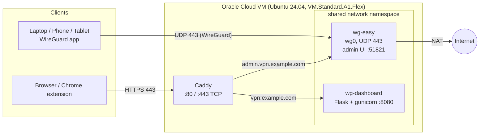

# Self-Hosted WireGuard VPN & Monitoring Dashboard

[Türkçe](README.tr.md)

A personal WireGuard VPN running on Oracle Cloud's Always Free tier, plus a small monitoring stack built on top of it: a token-protected Flask API, a web dashboard and a Manifest V3 Chrome extension that show server health, connected devices and the monthly egress quota.

Everything runs in Docker on a single ARM VM and costs nothing to operate.

## Features

- **WireGuard VPN** managed with [wg-easy](https://github.com/wg-easy/wg-easy), listening on **UDP 443** so it passes most institutional firewalls that block the default 51820 port.
- **Automatic HTTPS** via Caddy and Let's Encrypt, using a free [nip.io](https://nip.io) hostname (no domain purchase needed).
- **wg-easy admin panel behind HTTPS only**: its port is not exposed to the internet.
- **Monitoring API** (`GET /api/status`, Bearer token) reporting:
  - per-peer handshake time, online state and RX/TX bytes (`wg show wg0 dump`)
  - CPU, RAM, disk and uptime (`psutil`)
  - estimated monthly outbound traffic against Oracle's 10 TB Always Free limit
- **Web dashboard** (installable as a PWA) and a **Chrome extension popup** that consume the same API.
- **Least-privilege container design**: the API has no access to the Docker socket.

## Architecture



| Container | Image | Role |
|---|---|---|
| `wg-easy` | `ghcr.io/wg-easy/wg-easy` | WireGuard server and peer/QR management UI |
| `wg-dashboard` | built from `server/api` | Monitoring API and static web dashboard |
| `wg-dashboard-caddy` | `caddy:2-alpine` | TLS termination and reverse proxy |

`wg-dashboard` uses `network_mode: "container:wg-easy"`, so it shares the WireGuard container's network namespace. That lets it run `wg show wg0 dump` directly without mounting `/var/run/docker.sock`, and it is reachable by Caddy at `wg-easy:8080`.

## Repository layout

```
extension/                 Manifest V3 Chrome extension (popup)
server/
├── docker-compose.yml     wg-dashboard + Caddy
├── Caddyfile.example      reverse proxy config (copy to Caddyfile)
├── .env.example           DASHBOARD_TOKEN
├── devices.example.json   WireGuard IP → device name map
├── wg-easy.env.example    environment for the wg-easy container
├── api/                   Flask API (app.py, Dockerfile, requirements.txt)
└── web/                   dashboard (index.html, PWA manifest, icons)
```

## Setup

### 1. Oracle Cloud VM

1. Create an Always Free account and an instance:
   - Shape: `VM.Standard.A1.Flex` (Ampere ARM), 2 OCPU / 12 GB RAM was used here
   - Image: Ubuntu 24.04
   - Download the generated SSH key pair
2. Make sure the instance has a public IPv4 address.
3. Connect: `ssh -i <private-key> ubuntu@<PUBLIC_IP>`
4. Install Docker Engine and the Compose plugin following the [official guide](https://docs.docker.com/engine/install/ubuntu/), and add your user to the `docker` group.

### 2. Firewall

Traffic is filtered at two layers on OCI.

**OCI (cloud level)**

| Where | Direction | Protocol / Port | Source | Purpose |
|---|---|---|---|---|
| Default Security List (subnet) | Ingress | TCP 22 | 0.0.0.0/0 | SSH (OCI default) |
| Default Security List (subnet) | Ingress | ICMP 3, 4 | 0.0.0.0/0 | Path MTU discovery (OCI default) |
| Network Security Group (VM) | Ingress | **UDP 443** | 0.0.0.0/0 | WireGuard |
| Network Security Group (VM) | Ingress | **TCP 80** | 0.0.0.0/0 | Let's Encrypt HTTP challenge, HTTP→HTTPS redirect |
| Network Security Group (VM) | Ingress | **TCP 443** | 0.0.0.0/0 | Dashboard and admin UI via Caddy |
| Network Security Group (VM) | Egress | All | 0.0.0.0/0 | Outbound traffic |

Only the three NSG ingress rules were added; the rest are OCI defaults.

**VM (host level)**

No host firewall rules were added and `ufw` is not installed. Oracle's Ubuntu image ships an `iptables` `INPUT` chain that accepts SSH and rejects everything else. Ports published by Docker still work, because Docker DNATs them in the `nat` table and the packets traverse the `FORWARD` chain (`DOCKER` / `DOCKER-USER`), not `INPUT`.

> If you run a service directly on the host (not in Docker), you will need to open its port in `iptables` as well.

### 3. wg-easy

Generate a bcrypt hash for the admin password as described in the [wg-easy documentation](https://github.com/wg-easy/wg-easy), then:

```bash
mkdir -p ~/wg-dashboard
cp server/wg-easy.env.example ~/wg-dashboard/wg-easy.env
nano ~/wg-dashboard/wg-easy.env
```

Set `WG_HOST` to the VM's public IP and `PASSWORD_HASH` to your hash. Then start the container:

```bash
docker run -d \
  --name=wg-easy \
  --env-file ~/wg-dashboard/wg-easy.env \
  -v ~/.wg-easy:/etc/wireguard \
  -p 443:443/udp \
  --cap-add=NET_ADMIN \
  --cap-add=SYS_MODULE \
  --sysctl="net.ipv4.conf.all.src_valid_mark=1" \
  --sysctl="net.ipv4.ip_forward=1" \
  --restart unless-stopped \
  ghcr.io/wg-easy/wg-easy
```

Only UDP 443 is published. The admin UI (port 51821) is intentionally **not** exposed; it is reached through Caddy in the next step.

> This setup uses wg-easy's `WG_HOST` / `WG_PORT` / `PASSWORD_HASH` environment variables. Newer major versions of wg-easy may configure these differently; check the release notes before upgrading.

### 4. Monitoring API, dashboard and Caddy

Copy the `server/` directory to `~/wg-dashboard` on the VM, then:

```bash
cd ~/wg-dashboard
cp .env.example .env
cp devices.example.json devices.json
cp Caddyfile.example Caddyfile
```

- `.env`: set `DASHBOARD_TOKEN`, e.g. `openssl rand -hex 24`.
- `devices.json`: map each peer's WireGuard address (as shown in wg-easy) to a friendly name.
- `Caddyfile`: replace `vpn.example.com` with your hostname. Without a domain, use nip.io: an IP of `203.0.113.10` becomes `203-0-113-10.nip.io` and `admin.203-0-113-10.nip.io`.

Start the stack and attach wg-easy to the Compose network so Caddy can resolve it by name:

```bash
docker compose up -d --build
docker network connect wg-dashboard_default wg-easy
```

Check it:

```bash
curl -s -o /dev/null -w "%{http_code}\n" http://<your-hostname>
curl -s -H "Authorization: Bearer <DASHBOARD_TOKEN>" https://<your-hostname>/api/status
```

The first should return `308` (redirect to HTTPS); the second should return JSON.

### 5. Clients

Open the admin UI at `https://admin.<your-hostname>`, create one peer per device and import it in the official WireGuard app (config file on desktop, QR code on iOS / Android).

### 6. Chrome extension

1. Open `chrome://extensions` and enable **Developer mode**.
2. Click **Load unpacked** and select the `extension/` folder.
3. Open the popup, click the gear icon and enter:
   - **Dashboard URL**: `https://<your-hostname>`
   - **Token**: your `DASHBOARD_TOKEN`
4. Approve the permission prompt. The extension only requests access to the origin you enter (`optional_host_permissions`), not to all sites.

The URL and token are stored in `chrome.storage.local`.

## API

`GET /api/status` with header `Authorization: Bearer <token>`:

```json
{
  "peers": [
    {
      "name": "Laptop",
      "allowed_ips": "10.8.0.2/32",
      "endpoint": "198.51.100.7:51234",
      "latest_handshake": 1761400000,
      "connected": true,
      "rx_bytes": 123456,
      "tx_bytes": 654321,
      "public_key": "..."
    }
  ],
  "system": {
    "cpu_percent": 3.1, "memory_percent": 6.0, "disk_percent": 11.0,
    "uptime_seconds": 2419200
  },
  "egress": { "used_bytes": 8900000000, "limit_bytes": 10995116277760, "percent": 0.08, "month": "2026-10" },
  "wg_error": null,
  "egress_error": null,
  "generated_at": 1761400000
}
```

A peer counts as connected if its last handshake was less than 3 minutes ago.

## Design decisions

- **WireGuard instead of a SOCKS5 proxy.** iOS has no reliable system-wide SOCKS5 support, while WireGuard has native clients on every platform.
- **UDP 443 instead of 51820.** Many campus and corporate networks only allow well-known ports.
- **No Docker socket in the API container.** Mounting `/var/run/docker.sock` would effectively give the API root on the host. Sharing wg-easy's network namespace (plus `NET_ADMIN`) is enough to read `wg show`.
- **Why not read `/proc/net/dev` from the host?** That file reflects the network namespace of the reading process, not the host, so a bind mount does not expose host interface counters.
- **Admin UI behind Caddy.** Port 51821 was removed from the public internet and is only reachable over HTTPS.
- **Constant-time token comparison** (`hmac.compare_digest`) to avoid timing side channels.

## Known limitations

- Egress is estimated from the sum of WireGuard `tx_bytes`, so it ignores non-VPN traffic. WireGuard counters reset when the container restarts, which makes the monthly figure undercount after a reboot.
- Networks using deep packet inspection can still block WireGuard even on UDP 443. Tunnelling it over TLS (e.g. wstunnel) would be the next step.
- The SSH rule is open to `0.0.0.0/0` (key-based auth only). Restricting it to known IPs would be stricter.

## Maintenance

- `unattended-upgrades` installs security patches; run `sudo apt update && sudo apt upgrade -y` periodically and reboot for kernel updates. All containers use `restart: unless-stopped` and come back automatically.
- Docker images are not covered by `apt`; update wg-easy deliberately and read its release notes first.

## License

[MIT](LICENSE) © 2026 Yavuz Mete Afşar
