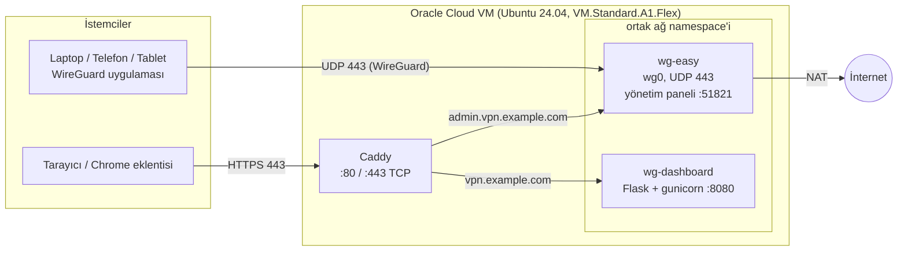

# Self-Hosted WireGuard VPN ve İzleme Paneli

[English](README.md)

Oracle Cloud Always Free üzerinde çalışan kişisel bir WireGuard VPN ve bunun üstüne kurulmuş küçük bir izleme sistemi: token korumalı bir Flask API, bir web paneli ve sunucu durumunu, bağlı cihazları ve aylık giden veri kotasını gösteren Manifest V3 bir Chrome eklentisi.

Her şey tek bir ARM VM üzerinde Docker ile çalışır ve işletme maliyeti sıfırdır.

## Özellikler

- **WireGuard VPN**: [wg-easy](https://github.com/wg-easy/wg-easy) ile yönetiliyor ve **UDP 443**'ten dinliyor. Böylece varsayılan 51820 portunu engelleyen kurumsal ağların çoğundan geçebiliyor.
- **Otomatik HTTPS**: Caddy ve Let's Encrypt ile, ücretsiz bir [nip.io](https://nip.io) hostname'i kullanılarak (alan adı satın almaya gerek yok).
- **wg-easy yönetim paneli yalnızca HTTPS arkasında**: portu internete açık değil.
- **İzleme API'si** (`GET /api/status`, Bearer token) şunları raporluyor:
  - cihaz başına son el sıkışma zamanı, çevrimiçi durumu ve RX/TX byte'ları (`wg show wg0 dump`)
  - CPU, RAM, disk ve uptime (`psutil`)
  - Oracle'ın 10 TB Always Free limitine göre tahmini aylık giden trafik
- **Web paneli** (PWA olarak kurulabilir) ve aynı API'yi kullanan **Chrome eklentisi**.
- **En az yetki ilkesiyle tasarlanmış container'lar**: API'nin Docker socket'ine erişimi yok.

## Mimari



| Container | Image | Görev |
|---|---|---|
| `wg-easy` | `ghcr.io/wg-easy/wg-easy` | WireGuard sunucusu ve peer/QR yönetim arayüzü |
| `wg-dashboard` | `server/api`'den build edilir | İzleme API'si ve statik web paneli |
| `wg-dashboard-caddy` | `caddy:2-alpine` | TLS sonlandırma ve reverse proxy |

`wg-dashboard`, `network_mode: "container:wg-easy"` ile WireGuard container'ının ağ namespace'ini paylaşır. Bu sayede `/var/run/docker.sock` mount etmeden doğrudan `wg show wg0 dump` çalıştırabilir, Caddy de ona `wg-easy:8080` adresinden ulaşır.

## Klasör yapısı

```
extension/                 Manifest V3 Chrome eklentisi (popup)
server/
├── docker-compose.yml     wg-dashboard + Caddy
├── Caddyfile.example      reverse proxy ayarı (Caddyfile olarak kopyalanır)
├── .env.example           DASHBOARD_TOKEN
├── devices.example.json   WireGuard IP → cihaz adı eşlemesi
├── wg-easy.env.example    wg-easy container'ının ortam değişkenleri
├── api/                   Flask API (app.py, Dockerfile, requirements.txt)
└── web/                   panel (index.html, PWA manifest, ikonlar)
```

## Kurulum

### 1. Oracle Cloud VM

1. Always Free hesabı aç ve bir instance oluştur:
   - Shape: `VM.Standard.A1.Flex` (Ampere ARM), burada 2 OCPU / 12 GB RAM kullanıldı
   - Image: Ubuntu 24.04
   - Oluşturulan SSH anahtar çiftini indir
2. Instance'ın public IPv4 adresi olduğundan emin ol.
3. Bağlan: `ssh -i <private-key> ubuntu@<PUBLIC_IP>`
4. Docker Engine ve Compose eklentisini [resmi rehbere](https://docs.docker.com/engine/install/ubuntu/) göre kur, kullanıcını `docker` grubuna ekle.

### 2. Firewall

OCI'de trafik iki katmanda filtrelenir.

**OCI (bulut katmanı)**

| Yer | Yön | Protokol / Port | Kaynak | Amaç |
|---|---|---|---|---|
| Default Security List (subnet) | Ingress | TCP 22 | 0.0.0.0/0 | SSH (OCI varsayılanı) |
| Default Security List (subnet) | Ingress | ICMP 3, 4 | 0.0.0.0/0 | Path MTU keşfi (OCI varsayılanı) |
| Network Security Group (VM) | Ingress | **UDP 443** | 0.0.0.0/0 | WireGuard |
| Network Security Group (VM) | Ingress | **TCP 80** | 0.0.0.0/0 | Let's Encrypt HTTP doğrulaması, HTTP→HTTPS yönlendirmesi |
| Network Security Group (VM) | Ingress | **TCP 443** | 0.0.0.0/0 | Caddy üzerinden panel ve yönetim arayüzü |
| Network Security Group (VM) | Egress | Tümü | 0.0.0.0/0 | Giden trafik |

Sadece üç NSG ingress kuralı elle eklendi, diğerleri OCI varsayılanı.

**VM (sunucu katmanı)**

Elle eklenmiş bir kural yok, `ufw` kurulu değil. Oracle'ın Ubuntu imajı, `iptables` `INPUT` zincirinde SSH'a izin verip geri kalan her şeyi reddeden kurallarla gelir. Docker'ın yayınladığı portlar yine de çalışır, çünkü Docker bunları `nat` tablosunda DNAT'lar ve paketler `INPUT` değil `FORWARD` zincirinden (`DOCKER` / `DOCKER-USER`) geçer.

> Docker dışında, doğrudan sunucuda bir servis çalıştırırsan onun portunu `iptables`'ta da açman gerekir.

### 3. wg-easy

Yönetim şifresi için bir bcrypt hash'i [wg-easy dokümantasyonunda](https://github.com/wg-easy/wg-easy) anlatıldığı gibi üret, sonra:

```bash
mkdir -p ~/wg-dashboard
cp server/wg-easy.env.example ~/wg-dashboard/wg-easy.env
nano ~/wg-dashboard/wg-easy.env
```

`WG_HOST`'u VM'in public IP'si, `PASSWORD_HASH`'i ürettiğin hash olarak ayarla. Ardından container'ı başlat:

```bash
docker run -d \
  --name=wg-easy \
  --env-file ~/wg-dashboard/wg-easy.env \
  -v ~/.wg-easy:/etc/wireguard \
  -p 443:443/udp \
  --cap-add=NET_ADMIN \
  --cap-add=SYS_MODULE \
  --sysctl="net.ipv4.conf.all.src_valid_mark=1" \
  --sysctl="net.ipv4.ip_forward=1" \
  --restart unless-stopped \
  ghcr.io/wg-easy/wg-easy
```

Yalnızca UDP 443 yayınlanır. Yönetim arayüzü (51821 portu) bilerek **açılmaz**, bir sonraki adımda Caddy üzerinden erişilir.

> Bu kurulum wg-easy'nin `WG_HOST` / `WG_PORT` / `PASSWORD_HASH` ortam değişkenlerini kullanır. wg-easy'nin yeni ana sürümleri bunları farklı şekilde yapılandırabilir; güncellemeden önce sürüm notlarına bak.

### 4. İzleme API'si, panel ve Caddy

`server/` klasörünü VM'de `~/wg-dashboard` içine kopyala, sonra:

```bash
cd ~/wg-dashboard
cp .env.example .env
cp devices.example.json devices.json
cp Caddyfile.example Caddyfile
```

- `.env`: `DASHBOARD_TOKEN`'ı ayarla, örneğin `openssl rand -hex 24` ile.
- `devices.json`: her peer'ın WireGuard adresini (wg-easy'de göründüğü gibi) okunabilir bir isimle eşle.
- `Caddyfile`: `vpn.example.com` yerine kendi hostname'ini yaz. Alan adın yoksa nip.io kullan: `203.0.113.10` IP'si `203-0-113-10.nip.io` ve `admin.203-0-113-10.nip.io` olur.

Stack'i başlat ve Caddy'nin wg-easy'yi isimle bulabilmesi için onu Compose ağına bağla:

```bash
docker compose up -d --build
docker network connect wg-dashboard_default wg-easy
```

Kontrol et:

```bash
curl -s -o /dev/null -w "%{http_code}\n" http://<hostname>
curl -s -H "Authorization: Bearer <DASHBOARD_TOKEN>" https://<hostname>/api/status
```

İlki `308` (HTTPS'e yönlendirme), ikincisi JSON döndürmeli.

### 5. İstemciler

Yönetim arayüzünü `https://admin.<hostname>` adresinden aç, her cihaz için bir peer oluştur ve resmi WireGuard uygulamasına aktar (masaüstünde config dosyası, iOS / Android'de QR kod).

### 6. Chrome eklentisi

1. `chrome://extensions` sayfasını aç, **Geliştirici modu**'nu etkinleştir.
2. **Paketlenmemiş öğe yükle**'ye tıkla ve `extension/` klasörünü seç.
3. Popup'ı aç, dişli simgesine tıkla ve şunları gir:
   - **Dashboard URL**: `https://<hostname>`
   - **Token**: `DASHBOARD_TOKEN` değerin
4. İzin isteğini onayla. Eklenti tüm sitelere değil, yalnızca girdiğin adrese erişim ister (`optional_host_permissions`).

URL ve token `chrome.storage.local` içinde saklanır.

## API

`Authorization: Bearer <token>` başlığıyla `GET /api/status` isteği, İngilizce README'deki örnekle aynı yapıda bir JSON döndürür: `peers`, `system`, `egress`, `wg_error`, `egress_error`, `generated_at`.

Bir peer'ın son el sıkışması 3 dakikadan yeniyse bağlı sayılır.

## Tasarım kararları

- **SOCKS5 proxy yerine WireGuard.** iOS'ta güvenilir, sistem geneli SOCKS5 desteği yok; WireGuard'ın ise her platformda resmi istemcisi var.
- **51820 yerine UDP 443.** Birçok kampüs ve şirket ağı yalnızca bilinen portlara izin veriyor.
- **API container'ında Docker socket yok.** `/var/run/docker.sock` mount etmek API'ye fiilen sunucuda root yetkisi verirdi. wg-easy'nin ağ namespace'ini paylaşmak (artı `NET_ADMIN`) `wg show` okumak için yeterli.
- **Neden sunucunun `/proc/net/dev` dosyası okunmuyor?** Bu dosya okuyan sürecin ağ namespace'ini yansıtır, sunucununkini değil; bind mount sunucu arayüz sayaçlarını göstermez.
- **Yönetim arayüzü Caddy arkasında.** 51821 portu internetten kaldırıldı, yalnızca HTTPS üzerinden erişilebiliyor.
- **Sabit zamanlı token karşılaştırması** (`hmac.compare_digest`): zamanlama yan kanalını önlemek için.

## Bilinen sınırlamalar

- Giden trafik WireGuard `tx_bytes` toplamından tahmin ediliyor, VPN dışı trafiği saymıyor. WireGuard sayaçları container yeniden başladığında sıfırlandığı için reboot sonrası aylık değer eksik kalabiliyor.
- Derin paket incelemesi (DPI) yapan ağlar WireGuard'ı UDP 443'te bile engelleyebilir. Bir sonraki adım trafiği TLS içinde tünellemek olur (ör. wstunnel).
- SSH kuralı `0.0.0.0/0`'a açık (yalnızca anahtar tabanlı giriş). Bilinen IP'lerle sınırlamak daha sıkı olur.

## Bakım

- `unattended-upgrades` güvenlik yamalarını kendiliğinden kurar. Düzenli olarak `sudo apt update && sudo apt upgrade -y` çalıştır, kernel güncellemelerinden sonra reboot et. Tüm container'lar `restart: unless-stopped` ile kendiliğinden geri gelir.
- Docker image'ları `apt` kapsamında değil; wg-easy'yi bilinçli şekilde, önce sürüm notlarını okuyarak güncelle.

## Lisans

[MIT](LICENSE) © 2026 Yavuz Mete Afşar
